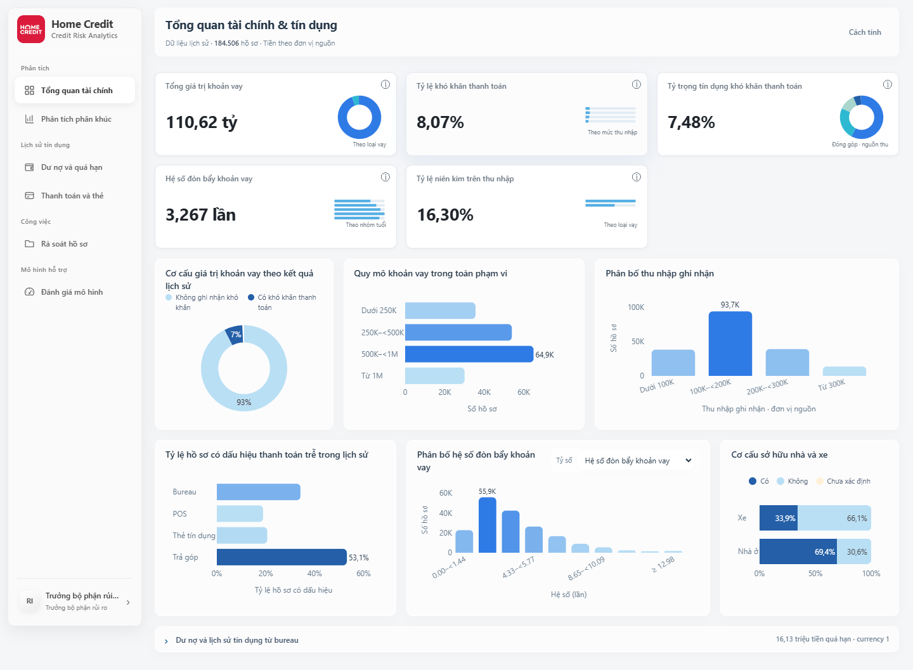
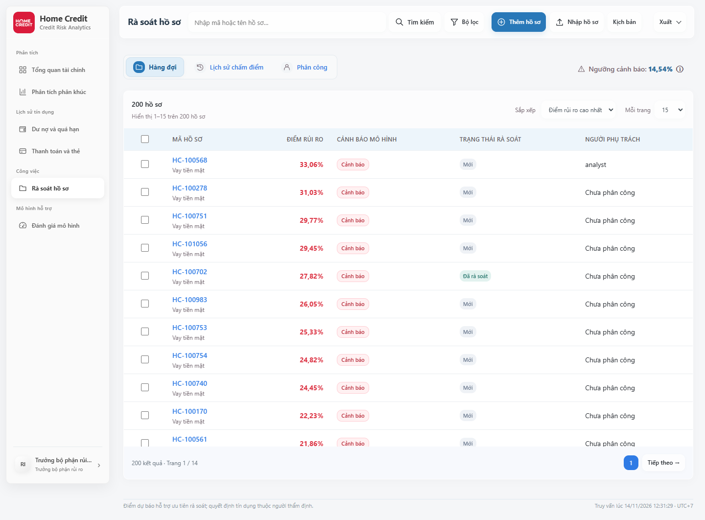
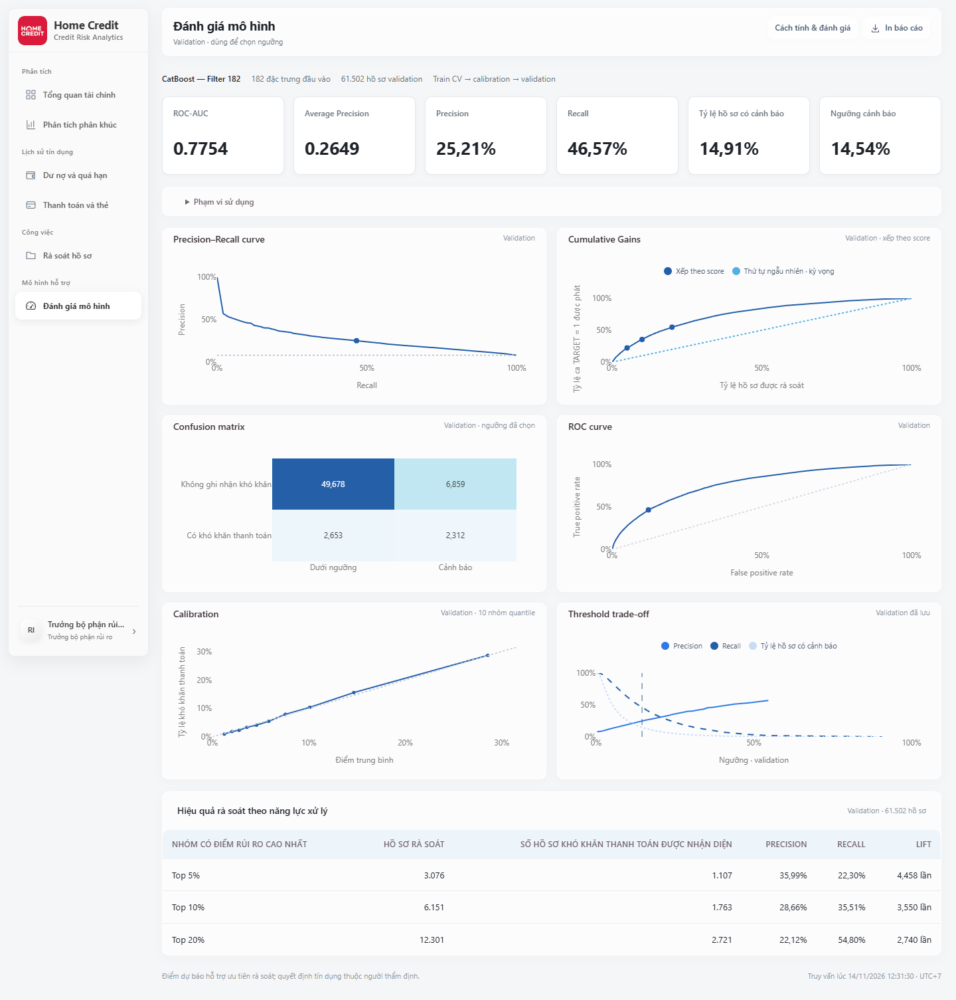
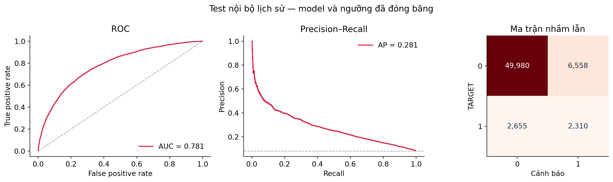

# Home Credit — Dự báo rủi ro thanh toán của khách hàng vay

Dự án được thực hiện trong môn Học máy trong phân tích kinh doanh, sử dụng bộ dữ liệu
Home Credit Default Risk để xây dựng mô hình dự báo rủi ro thanh toán. Mỗi dự báo
tương ứng với một hồ sơ `SK_ID_CURR`, trong đó `TARGET = 1` là lớp có rủi ro.

Bên cạnh các notebook phân tích và huấn luyện, dự án có dashboard Flask để xem
thông tin danh mục, tra cứu hồ sơ, chấm điểm và hỗ trợ sắp xếp thứ tự rà soát.
Ứng dụng có ba vai trò: quản trị hệ thống, trưởng bộ phận rủi ro và chuyên viên tín dụng.

## Tính năng chính

- Xem tổng quan tài chính, phân tích danh mục và các nhóm rủi ro.
- Tra cứu hồ sơ, lịch sử tín dụng và thông tin các kỳ thanh toán.
- Chấm điểm bằng CatBoost, xem đóng góp của các đặc trưng và mô phỏng khi thay đổi đầu vào.
- Quản lý phân công, trạng thái rà soát, ghi chú và lịch sử chấm điểm.
- Phân quyền theo ba vai trò, với phạm vi truy cập phù hợp cho từng tài khoản.

Dashboard sử dụng mô hình đã lưu nên bạn có thể chạy ứng dụng mà không cần huấn luyện lại.

## Một số hình ảnh giao diện

Các ảnh dưới đây được chụp trực tiếp từ ứng dụng ngày 14/11/2026, bằng tài khoản trưởng bộ phận rủi ro. Số liệu trên màn hình phụ thuộc vào dữ liệu và quyền truy cập của tài khoản.

### Tổng quan tài chính và tín dụng

Trang tổng quan tập hợp các chỉ số và biểu đồ để người dùng theo dõi cơ cấu khoản vay, thu nhập và các dấu hiệu thanh toán trong lịch sử.



### Rà soát hồ sơ

Danh sách 200 hồ sơ demo hiển thị điểm rủi ro, cảnh báo mô hình, trạng thái rà soát và người phụ trách, cùng các công cụ tìm kiếm, lọc và phân công.



### Thông tin và đánh giá mô hình

Trang mô hình hiển thị các chỉ số trên tập validation, đường Precision–Recall, ROC, ma trận nhầm lẫn và hiệu quả rà soát theo số lượng hồ sơ.



## Công nghệ sử dụng

| Thành phần | Công nghệ |
|---|---|
| Xử lý và phân tích dữ liệu | Python, pandas, NumPy, SciPy |
| Xây dựng và đánh giá mô hình | scikit-learn, CatBoost, XGBoost |
| Cơ sở dữ liệu | MySQL, mysql-connector-python |
| Ứng dụng web | Flask, HTML, CSS, JavaScript |
| Trực quan hóa | Plotly, Matplotlib |
| Notebook nghiên cứu | Jupyter |
| Kiểm thử | pytest, Node.js |

## Cấu trúc thư mục

| Thư mục | Nội dung |
|---|---|
| `configs/` | Cấu hình kết nối và thiết kế thực nghiệm |
| `connectors/` | Kết nối, truy vấn và ghi dữ liệu MySQL |
| `models/` | Hiểu dữ liệu, chuẩn bị đặc trưng, huấn luyện và dự báo |
| `utils/` | Tiện ích đọc metadata |
| `web/` | Ứng dụng Flask, HTML, CSS, JavaScript và font |
| `sql/` | Schema, truy vấn và index |
| `notebooks/` | Tám notebook nghiên cứu theo thứ tự 01–08 |
| `data/` | Dữ liệu nguồn, phân tập, đặc trưng và bản sao lưu database |
| `artifacts/` | Mô hình đã huấn luyện và thông tin phục vụ dự báo |
| `reports/` | Bảng, hình và kết quả thực nghiệm |
| `scripts/` | Công cụ khôi phục dữ liệu, kiểm tra và vận hành |
| `tests/` | Kiểm thử Python và JavaScript |
| `docs/images/` | Ảnh giao diện dùng trong README |

## Yêu cầu môi trường

Dự án được xây dựng và kiểm tra trên Windows với Python 3.14 và MySQL 8.0.
Các lệnh dưới đây chạy trong PowerShell, tại thư mục chứa README này.
Nên dùng đúng phiên bản thư viện trong `requirements.txt` để tải được mô hình đã lưu.

Để chạy dashboard, bạn cần có database đã khôi phục cùng mô hình và các tệp đi kèm trong `artifacts/`. Xem [hướng dẫn database](data/database/README.md) và [tài liệu mô hình đã lưu](artifacts/README.md) để chuẩn bị các tệp cần thiết. Node.js cần được cài nếu muốn chạy đầy đủ kiểm thử JavaScript.

## Cài đặt và chạy

### 1. Cài thư viện

Tải hoặc clone dự án về máy, mở terminal tại thư mục chứa README này, rồi tạo môi trường Python:

```powershell
py -3.14 -m venv .venv
.venv\Scripts\python.exe -m pip install -r requirements.txt
```

### 2. Chuẩn bị database và cấu hình kết nối

Khôi phục database theo [hướng dẫn dữ liệu](data/database/README.md).
Đặt thông tin kết nối bằng `MYSQL_HOST`, `MYSQL_PORT`, `MYSQL_DATABASE`,
   `MYSQL_USER`, `MYSQL_PASSWORD`. Hoặc sao chép
   `configs/mysql_connection.local.example.json` thành
   `configs/mysql_connection.local.json` và điền mật khẩu MySQL trên máy của bạn.
   File mẫu chỉ cấu hình mật khẩu; host, port, user và database đọc từ biến môi trường
   hoặc `configs/mysql_connection.json`.
   `mysql_connection.local.json` là cấu hình riêng để chạy trên máy hiện tại;
   khi chia sẻ dự án, chỉ gửi file mẫu `.example.json` và giữ file chứa mật khẩu trên máy.

### 3. Khởi động ứng dụng

Khi đã khôi phục đầy đủ database và cấu hình kết nối, chạy:

```powershell
.venv\Scripts\python.exe web/app.py
```

Truy cập **http://127.0.0.1:5000** trong trình duyệt. Đăng nhập bằng tài khoản được cấp cho bản demo; thông tin truy cập được trao đổi ngoài repository. Tài khoản dashboard được quản lý riêng với tài khoản kết nối MySQL.

Nếu cổng 5000 đang được sử dụng, bạn có thể chạy ở cổng khác:

```powershell
.venv\Scripts\python.exe web/app.py --port 5001
```

Lần đầu mở dashboard có thể mất nhiều thời gian hơn vì ứng dụng cần truy vấn
dữ liệu lịch sử và tạo cache.

Database đã khôi phục đầy đủ không cần chạy lại `--init-db` hoặc `--init-users`.
Nếu tự xây database từ nguồn, xem [hướng dẫn SQL](sql/README.md).

## Hướng dẫn sử dụng

1. Đăng nhập bằng tài khoản phù hợp với vai trò muốn trải nghiệm.
2. Với tài khoản trưởng bộ phận rủi ro hoặc chuyên viên tín dụng, mở trang tổng quan để theo dõi các chỉ số. Dữ liệu hiển thị phụ thuộc vào quyền truy cập.
3. Vào danh sách hồ sơ, tìm hồ sơ cần xem rồi mở trang chi tiết để tra cứu thông tin, chấm điểm và xem phần diễn giải. Dùng chức năng mô phỏng để xem điểm thay đổi thế nào khi điều chỉnh đầu vào.
4. Cập nhật trạng thái rà soát và ghi chú trong quá trình xử lý. Trưởng bộ phận rủi ro có thể quản lý phân công; quản trị hệ thống quản lý tài khoản và xem nhật ký thao tác.

Hồ sơ trong bản demo được chọn từ `application_test` đã có sẵn đặc trưng. Ứng dụng hiện chưa có quy trình tiếp nhận một hồ sơ gốc hoàn toàn mới. Xem thêm [hướng dẫn dashboard](web/README.md) để biết phạm vi các chức năng.

## Quy trình nghiên cứu

```text
8 bảng nguồn → MySQL raw_* → hiểu dữ liệu và chất lượng
→ đặc trưng A/B → chọn biến → huấn luyện/đánh giá → artifact → Flask
```

Các notebook được chạy theo thứ tự trong [hướng dẫn notebook](notebooks/README.md),
với kernel mới cho mỗi notebook. Notebook 02 chuẩn bị dữ liệu cho phần khám phá
ở notebook 03. Tiếp theo, notebook 04 xây dựng hai bộ đặc trưng A/B, notebook 05
chọn biến, notebook 06 so sánh mô hình, notebook 07 đánh giá và notebook 08 diễn giải kết quả.

Dashboard sử dụng mô hình đã lưu nên có thể chạy mà không cần huấn luyện lại.

Dữ liệu được chia thành train, validation và test theo tỷ lệ 60/20/20, phân tầng theo `TARGET`, với seed 42. Kiểm định chéo gồm ba fold và chỉ thực hiện trên tập train. Thông tin phân tập được lưu trong `application_split` và `data/splits/`.

Bộ A gồm 127 biến, bộ B gồm 199 biến. Bộ Filter cuối có 182 biến; trong kiểm định chéo, bước chọn biến được thực hiện riêng cho từng fold, còn 181 biến ở mỗi fold.

## Mô hình và kết quả

Dashboard sử dụng CatBoost với độ sâu 6, 500 vòng huấn luyện và 182 biến đầu vào.
Điểm dự báo được giữ ở dạng raw score, với ngưỡng cảnh báo
`0.14539365168823878` (khoảng 14,5394%).

Mô hình được chọn dựa trên AP trung bình qua các fold kiểm định chéo. Các phương án
hiệu chỉnh xác suất được so sánh trên tập train; ngưỡng cảnh báo được chọn trên
tập validation theo giả định chi phí `5FN + FP`. Khi người dùng thao tác trên web,
ứng dụng chỉ tải mô hình và dự báo.

Kết quả đã ghi nhận trên tập test:

| Chỉ số | Kết quả |
|---|---|
| AP | 0,280743 |
| ROC-AUC | 0,781073 |
| Precision | 26,05% |
| Recall | 46,53% |

Biểu đồ dưới đây trình bày kết quả trên tập test nội bộ lịch sử. Đây là tập đánh giá khác với tập validation được hiển thị ở ảnh giao diện phía trên.



Tập test này đã được xem xét trong quá trình phát triển, vì vậy các kết quả trên
cần được hiểu trong phạm vi thực nghiệm của đồ án. Điểm dự báo dùng để hỗ trợ
ưu tiên thẩm định, chưa được xác nhận là xác suất vỡ nợ trong 12 tháng và không
thay thế quyết định cho vay. Dự án cũng chưa đo lường lợi ích tài chính trong thực tế.

Xem [kết quả mô hình](reports/modeling/README.md),
[artifact](artifacts/README.md) và [hướng dẫn web](web/README.md).

## Kiểm thử

```powershell
.venv\Scripts\python.exe -m pip install -r requirements-dev.txt
.venv\Scripts\python.exe -m pytest tests -q -p no:cacheprovider
```

Máy cần có Node.js để chạy đầy đủ các kiểm thử JavaScript. Khi chạy lệnh pytest
ở trên, các kiểm thử Python liên quan sẽ tự gọi Node.js.

Cache và dữ liệu tạm của quá trình kiểm thử được lưu trong `tmp/`. Bạn có thể
xóa thư mục này sau khi dừng ứng dụng.

## Trao đổi và đóng góp

Nếu gặp lỗi, bạn có thể tạo Issue trên repository, ghi rõ chức năng đang dùng, các bước thực hiện và thông báo lỗi. Với đề xuất chỉnh sửa, hãy mô tả mục đích thay đổi trong pull request và chạy các kiểm thử liên quan trước khi gửi.

Trước khi chia sẻ log hoặc cấu hình, hãy bỏ mật khẩu, khóa truy cập và thông tin kết nối riêng của máy.

## Nguồn tham khảo

- [Home Credit Default Risk](https://www.kaggle.com/competitions/home-credit-default-risk/data)
  và từ điển gốc `data/metadata/HomeCredit_columns_description.csv`.
- Bài giảng và ví dụ của Trần Duy Thanh: tổ chức Connector, đọc dữ liệu MySQL,
  Preparing Data, huấn luyện, lưu/tải và tích hợp model. Các lớp đã được điều chỉnh
  cho dữ liệu và yêu cầu của đồ án; không phải bản sao nguyên trạng ví dụ.
- Rose & Hudgins (2008), Bank Management & Financial Services, chương 16 và 18.
